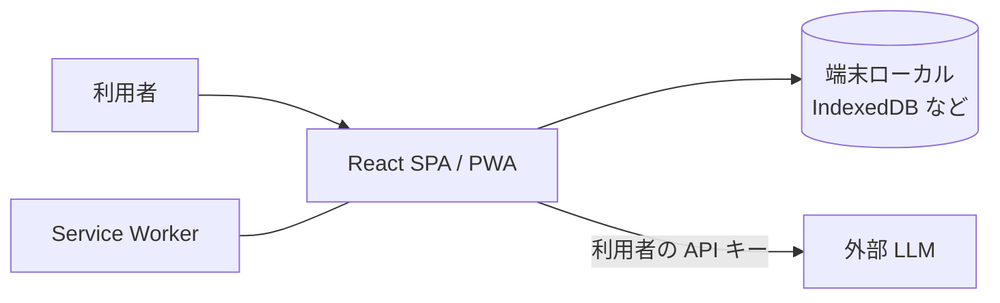

# アーキテクチャ

要件が固まるまでは方針のみ。実装が進んだら更新する。

## 方針

* 当面はクライアントのみ（SPA / PWA）。必要になった時点でサーバーを追加する
* プロセス構成はメインスレッド + Service Worker。必要に応じて Web Worker / WASM を導入する
* ストレージは端末ローカル（IndexedDB など）。外部 DB が必要になった時点で導入する
* AI は利用者の API キーでブラウザから直接呼ぶ方式を基本とする



## ディレクトリ構成（方針）

機能単位 + 共通の構成で、細かめに分ける。ファイル・ディレクトリ名は kebab-case。
分割は行数ではなく責務で決め、汎用的なものと固有のものを分ける。

```
src/
  features/   # 機能単位（基礎練習・イラスト練習・ツール説明・AI など）
  components/ # 汎用 UI コンポーネント
  hooks/      # 汎用 hooks
  lib/        # 共通処理
```

実際の構成は実装に合わせて更新する。
