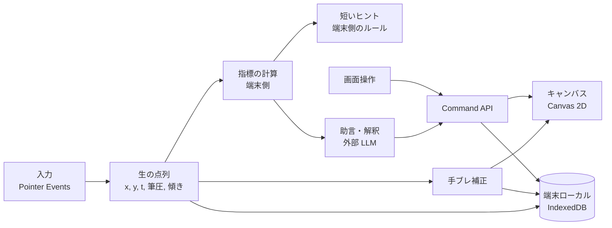

# アーキテクチャ

要件（[requirements.md](requirements.md)）に基づく方針。実装が進んだら更新する。

## 方針

* 当面はクライアントのみ（SPA / PWA）。必要になった時点でサーバーを追加する
* プロセス構成はメインスレッド + Service Worker。必要に応じて Web Worker / WASM を導入する
* ストレージは端末ローカル（IndexedDB）。外部 DB が必要になった時点で導入する
* AI は利用者の API キーでブラウザから直接呼ぶ方式を基本とする
* 機能は Command として包み、画面操作と AI の両方から同じ入口で呼ぶ

## 全体像



* 分析は補正前の**生の点列**で行う。補正後の線は見た目用。両方を保存する
* LLM には画像ではなく指標（数値）を渡すのを基本とする。LLM を毎ストロークで呼ばない
* 外部 LLM へ送るデータは、送信前に利用者へ明示する

## 描画

* 当面は Canvas 2D。足りなくなったら WebGL2 / WebGPU を検討する
* 描画中のストロークを描く層と、確定済みの絵を描く層を分け、書き味（遅延）を優先する
* 筆圧・傾きなどの機能は実行時に検出し、無い環境でも動かす
* 遅延とサンプリング頻度は実機（iPad Pro 11 インチ第 1 世代）で測定済み。Pencil は約 240 Hz、イベントから描画まで約 1 フレーム。結果と未確認の項目は [requirements.md](requirements.md) の「PWA かネイティブか」と調査メモを参照

## 開発環境（iPad での実機確認）

筆圧・傾き・遅延・PWA の挙動は iPad の実機でしか確認できないため、開発中に iPad から動作中のアプリを開けるようにする。

* iPad から Mac の開発サーバーへ LAN 経由でアクセスする場合、`http://<LAN の IP>` は安全なコンテキスト（HTTPS）にならないため、Service Worker や PWA のインストール、`navigator.storage.persist()` が使えない。HTTPS が必要
* HTTPS で開く方法の候補

| 方法 | 内容 | 長所 | 短所 |
| --- | --- | --- | --- |
| ローカル証明書 | mkcert などで証明書を作り、iPad に証明書を入れて信頼する | 外部サービス不要 | iPad での証明書の設定が手間 |
| トンネル | Cloudflare Tunnel などで開発サーバーを HTTPS で公開する | 設定が簡単。証明書不要 | 外部サービスを経由する。URL を知る人が見られる |
| VPN | Tailscale などで同じネットワークに入り、HTTPS 証明書を使う | 外部に公開しない | アカウント・導入が必要 |
| プレビューのデプロイ | PR ごとに Cloudflare Pages などへデプロイする | 実際の公開に近い環境で確認できる | 反映に時間がかかり、開発中の確認には遅い |

* Mac の Safari の「開発」メニューから、USB で接続した iPad の Safari / ホーム画面アプリを Web インスペクタで調べられる（コンソール、ネットワーク、ストレージ）
* Playwright の WebKit は実機の iPad Safari とは別物で、Apple Pencil の入力も再現できない。実機確認の代わりにはならない
* **mkcert を使う**（#9 で決定）。外部サービスもアカウントも要らず、iPad に入れたルート CA は正式に信頼されるため、Service Worker・PWA・`navigator.storage.persist()` まで確かめられる。トンネルは外部サービスを経由して URL が公開され、VPN はアカウントと導入が要る。プレビューのデプロイは開発中の確認には遅い
* `.cert/dev.pem` と `.cert/dev-key.pem` があるときだけ、`vite.config.ts` が開発サーバーとプレビューを HTTPS にする。無ければ HTTP のまま（`.cert/` は `.gitignore`）
* `bun run dev` は localhost のみ。iPad 用の `dev:ipad` / `preview:ipad` だけ `--host` で LAN に公開する。`allowedHosts` は `.local` を許可する
* 手順は [ipad-dev.md](ipad-dev.md)
* 入力検証ページ（画面は `src/pages/input-lab-page.tsx`、部品は `src/features/input-lab/`、`#input-lab`）は開発専用で、当分は残す（#9 時点の判断。#10 以降の入力の確認と、スローモーション撮影での遅延測定に使う）。開発サーバーと `build:lab`（`vite build --mode lab`）にだけ含め、通常のビルドからは取り除く（`import.meta.env.DEV || MODE === "lab"` の条件で `lazy import` する）

## PWA

* `vite-plugin-pwa`（Workbox の `generateSW`）で Manifest と Service Worker を生成する。ビルドのたびにファイル名のハッシュが変わるため、キャッシュ対象の一覧を手で管理せず、ビルドの成果物から自動生成する
* 更新は `registerType: "autoUpdate"`（新しい版を自動で適用する）。描画データを扱うようになったら、描画中に更新が入らないよう更新の確認 UI（`prompt`）に切り替える
* 開発サーバー（`bun run dev`）では Service Worker を登録しない。PWA の確認は `bun run build` → `bun run preview` で行う。iPad で検証ページ込みで確認するときは `bun run build:lab`（`dist-lab/` に出力。`dist/` とは別）→ `bun run preview:ipad`
* 実機（#9）で、配信中のビルドを別のビルドに差し替えたあとに、ホーム画面のアプリが真っ白になった。ハッシュ付きのファイルが入れ替わったことが原因の可能性があるが、未検証で、再現条件は特定できていない。開発中は、配信中の `dist-lab/` を作り直さない（[ipad-dev.md](ipad-dev.md)）。公開後は、古いファイルを残す、または更新の確認 UI（`prompt`）に切り替えることを検討する
* 設定は `vite.config.ts`。Manifest の名前・アイコンは仮。アイコンの元は `public/icon.svg`

## ディレクトリ構成

機能単位 + 共通の構成で、細かめに分ける。ファイル・ディレクトリ名は kebab-case。
分割は行数ではなく責務で決め、汎用的なものと固有のものを分ける。

```
public/         # 静的ファイル（アイコンなど）
src/
  pages/        # 画面。features の部品を組み合わせる（input-lab-page など）
  features/     # 機能単位（診断・基礎練習・イラスト練習・ツール学習・AI チャットなど）
    input-lab/  # 入力検証の部品（開発専用。通常のビルドには含めない）
  components/
    ui/         # shadcn/ui のコンポーネント（生成物）
  hooks/        # 汎用 hooks（use-hash など）
  lib/          # 共通処理（cn、今後はストローク、指標の計算、Command など）
  app.tsx       # トップ画面
  main.tsx      # エントリ
  index.css     # Tailwind とテーマ変数
```

* `@/` は `src/` を指す（`tsconfig.app.json` と `vite.config.ts`）
* テストは対象の隣に `*.test.ts` で置く（`bun test`）。型チェックはアプリ用（`tsconfig.app.json`）とテスト用（`tsconfig.test.json`）に分けている
