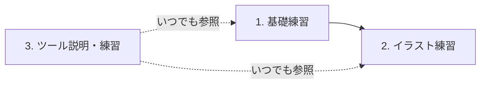

# 要件

イラストを描く練習アプリ（仮）の要件。まだ固まっていない部分が多く、決まり次第更新する。

## 目的

本当の初心者が、段階的にイラストを描けるようになる。

## 練習の段階

### 1. 基礎練習

* 線・図形・デッサンなどの基礎。トレースなど模範的な練習を行う
* 既存サイト・既存の練習法を模倣する（差別化は考えない）
* 参考候補: drawabox.com（要調査）

### 2. イラスト練習

* 目・鼻などパーツ単位の練習
* タッチや絵柄の違いを考慮する
* ステップアップ式
* 具体的な内容は未定（要調査）

### 3. ツール説明・練習

* お絵描きツールは機能が多く、初心者には何か分からない
* ペンの種類など、何を描く時に何を使うかを教える

## AI agent

### 採点・助言

* 1〜3 すべてで行う
* 完成した絵だけでなく、描画中のストローク（筆圧・ぶれ・速度など）も判断材料にする
* 手順の指摘もする（例: いきなり目を描き始めたら、まず全体のアタリを促す）

### 質問環境

* 利用者が AI agent に質問できる
* 機能を Command として包み、AI から操作・質問できるようにする（参考: fujibayashi-ast/ai-friendly）

## 未決事項

* プロジェクト名
* 各段階の具体的な練習メニュー
* 描画中の動作を記録する方法（ストロークの記録 / 録画）
* AI の実行方式（利用者の API キーでブラウザから直接呼ぶ方式を基本とし、ブラウザ内 LLM の併用も検討）
* ネイティブ機能が必須かどうか（必須ならモバイルアプリを検討）
* リリース・公開方法
