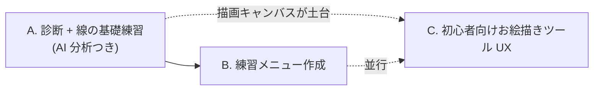
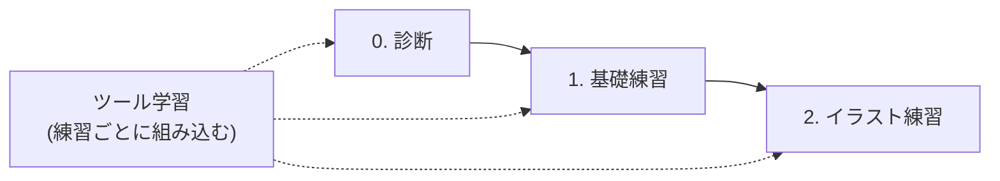

# 要件

イラストを描く練習アプリ（仮）の要件。調査と対話で決めた内容をまとめる。決まっていない点は「未決事項」に残し、決まり次第更新する。

調査の根拠と確度は [調査メモ](#調査メモ) を参照（確認日: 2026-10-18）。

## 目的と成功の目安

最終地点は「絵が上達すること」。アプリはそのための手段で、上達につながる別のアプローチがあれば試す。

成功の目安は次の 3 点。

* 線を描くなどの基礎練習がやりやすい
* 描画中も含めた高性能な AI フィードバックがある
* 初心者に分かりやすい UI・UX のお絵描きツールになっている

## 前提

| 項目 | 内容 |
| --- | --- |
| 利用者 | まず自分。良さそうなら公開する（イラスト練習をしたい本当の初心者向け） |
| 開発者の環境 | iPad Pro 11 インチ（iPadOS 26.7.1）+ Apple Pencil 第 2 世代（A2051） |
| 形態 | Web / PWA。書き味（描画の遅延）が実用に耐えない場合のみ、ネイティブを検討する |
| 悩み（開発者） | トレースならなんとか描けるが、子供の絵のようになる。原因は自分でも分からない。Clip Studio のペン・レイヤーなどの使い方が分からない |

## 進め方

* A は上達の仮説「描画中の指摘は、描いた後の評価より効く」を最短で検証するため、最初に作る
* C は軽量なお絵描きツールから始め、必要に応じて機能を足す

## 練習の構成

ツールの説明・練習は独立した段階にせず、**すべての練習に最初から組み込む**。目的は、ツールの使い方が分かることと、いろんなペンを使えるようになること。

### 0. 診断

* 短い課題（直線、円、模写など）から弱点を特定し、練習を提案する。
* 原因が自分では分からない利用者が多いため、原因の特定自体を最初の価値にする。
* 弱点の分類: 線の質 / 形（プロポーション）/ 立体（構造・奥行き）/ パーツ

### 1. 基礎練習（叩き台）

drawabox など既存の練習法を参考にする。差別化は考えない。

1. 直線（肩から動かす。始点と終点を決めて引く）
2. ゴースト線（空振りしてから引く）と重ね線
3. 曲線、S 字
4. 円と楕円（2〜3 周なぞってから離す）
5. 基本図形（四角、三角）
6. 立体（箱、円柱）
7. トレース（お手本をなぞる）

* drawabox の Lesson 1 は、線・楕円・箱（パース）の順。箱は重く、本当の初心者には難しい可能性があるため、後ろに回すか簡略化を検討する。
* drawabox の線の原則は、診断の指標に対応する（途切れない → 停止回数、滑らか → ジャーク、一貫した軌道 → 直線度と弧）。

### 2. イラスト練習

* 目・鼻などのパーツ単位、タッチや絵柄の違いを考慮する。ステップアップ式にする。
* 具体的な内容は未定。要調査。

### ツール学習

* 練習ごとに「今回使う道具」を持たせる。道具は**練習ごとに新しいものを 1 つ**導入し、そのペンの特徴と使いどころを短く説明する。
* ペンは 1 本から始めて徐々に増やす。導入順の案は、ライナー（太さ均一）→ 鉛筆（筆圧で濃さが変わる）→ G ペン（筆圧で太さが変わる）。
* 1 本目をライナーにする理由は、太さが一定で、動き（震え・速度）の指標だけが残り、分析を検証しやすいため。
* 手ブレ補正のような設定も同じ流れで学ぶ（震えを検知 → 補正を上げる提案 → 効果を確認）。
* 画面には、いま使う道具だけを出す（他は隠す・ロックする）。

## 最小のお絵描きツール（C の初期範囲）

* ペン 1 本（ライナー）、消しゴム、取り消し / やり直し、手ブレ補正（強さを変えられる）
* レイヤーなどは必要になった時点で追加する
* チュートリアル・ヘルプ・AI チャットは、画面の中に配置する（下記「ツールの UI・UX」）

## AI

### 採点・助言

* 診断・基礎練習・イラスト練習のすべてで行う。完成した絵だけでなく、描画中のストロークも判断材料にする。
* 手順の指摘もする（例: いきなりパーツを描き始めたら、まず全体のアタリを促す）。
* 標準の合格ラインはないため、点数よりも**自分の過去との比較（基準線）**と**具体的な助言**を中心にする。

#### 分担

| 担当 | 内容 |
| --- | --- |
| 端末側（決まった計算） | 線の質の指標を計算する。TypeScript で足りる見込み（1 ストロークが数百点程度のため） |
| LLM | 指標（数値）を受け取り、解釈・助言・手順の指摘を行う。画像は形や構図のおおまかな判定にだけ使う |

LLM は画像から細かい線の質を診断するのが不安定なため、線の質は数値で測る。

#### 指標

| 見たいこと | 指標 | 元データ |
| --- | --- | --- |
| 線が滑らか・自信がある | 正規化ジャーク、SPARC | 速度の変化 |
| ためらい・途中で止まる | 速度の停止回数、加減速の反転回数 | 速度 |
| 手の震え | 進行方向に垂直な動きの 4〜12 Hz 成分 | 座標 + 時刻 |
| 線のまっすぐさ | 直線からのずれ | 座標 |
| 弧を描いてしまう | ずれの向きの偏り | 座標 |
| 終点の行き過ぎ | 終点と狙った点の差 | 座標 |
| 円の閉じ具合 | 楕円からのずれ、閉じていない幅 | 座標 |
| 力みや筆圧の乱れ | 筆圧の分散・急変 | 筆圧 |

* **分析は補正前の生の入力で行う**。手ブレ補正後の線で測ると震えが隠れる。生の点列と補正後の線の両方を保存する。
* 入力デバイスの能力に応じて、分析する項目を切り替える（筆圧がなければ筆圧の項目を飛ばす）。

#### 症状と対処の対応表

症状ごとに「ツール設定」と「練習」の対処を持つ。診断（0）とツール学習がここでつながる。

| 症状 | ツール設定 | 練習 |
| --- | --- | --- |
| 震え | 手ブレ補正を強める | 肩から動かす直線 |
| 途中で止まる | - | ゴースト線 |
| 終点の行き過ぎ | - | ゴースト線、終点を意識する練習 |
| 筆圧の乱れ | 筆圧の設定を見直す | 力を抜く練習 |

内容は練習メニューと一緒に育てる。AI の提案は、その場で設定を変えるボタンにできる（Command API 経由）。

#### フィードバックのタイミング

* **ペンを離した直後**に、端末側のルールで短いヒントを出す（例: 「震えています。手ブレ補正を上げますか？」）。
* 詳しい助言は、練習のまとまりごと、または質問されたときに LLM が行う。
* 描画の最中の通知は、集中を妨げやすいため基本はしない。
* LLM を毎ストロークで呼ぶことはしない（遅延と費用のため）。

### 質問環境

* 利用者が AI agent に質問できる。
* 機能を Command として包み、AI から操作・質問できるようにする（参考: fujibayashi-ast/ai-friendly、daw-tool）。
* 外部 LLM は、利用者の API キーでブラウザから直接呼ぶ方式を基本とする。API キーと描画データは端末内に留め、外部へ送る場合は事前に利用者へ明示する。ブラウザ内 LLM の併用も検討する。

## ツールの UI・UX

* 初心者が迷う原因は、機能の多さと、いつ何を使うかが分からないこと。**画面にはいま必要なものだけを出す**（段階的な開示）。
* 説明は最初に長いツアーで行わず、**使う瞬間に 1 つだけ**出す（小さなヒント、次の行動につながる、閉じても困らない）。
* AI チャットは画面内に置き、質問に答えるだけでなく、設定の変更や操作の実演もできる。
* 配置（チュートリアル・ヘルプ・AI チャット）の具体案は、最小キャンバスの Issue で設計する。
* UI は shadcn/ui + Tailwind CSS で作る。

## 入力とデータ

### 入力

* Pointer Events で、座標・時刻・筆圧・傾きを取得する。指・マウス・他のペンでも動く。
* 機能は実行時に検出する（`getCoalescedEvents` などが無い環境でも動く）。
* 取れる情報は入力によって異なる。

| 入力 | 座標・時刻 | 筆圧 | 傾き |
| --- | --- | --- | --- |
| Apple Pencil（第 2 世代 / Pro） | 取れる | 取れる | 取れる |
| Apple Pencil（USB-C） | 取れる | 取れない（要確認） | 取れる |
| 指・マウス | 取れる | 取れない | 取れない |
| 他のペン | 取れる | 機種による | 機種による |

### データの持ち方

* 描画データは**ストロークの記録**を基本にする。各点に座標・時刻・筆圧・傾きを持たせる。見た目の画像は、ストロークから描き直して作る。
* 操作は Command のログとして残す。
* 録画（動画）は今回はやらない。将来、手の持ち方や姿勢を見たい場合に、外部の撮影や画面録画との連携を検討する。
* 保存は端末内（IndexedDB）。iOS では保存が消える可能性があるため、**エクスポート / バックアップ機能**と `navigator.storage.persist()` を併用する。

## PWA かネイティブか

**まず PWA で始める。** このアプリで効く制限は次のとおりで、いずれも許容できる。

| 制限 | 影響 |
| --- | --- |
| iOS で保存が消える可能性 | あり。エクスポートで対処 |
| Pencil Pro のスクイーズ・ダブルタップが取れない | 小さい。画面上の UI で足りる |
| ホバーが使えない（ホバー中は傾きも取れない） | 小さい。iPad Pro 11 インチ第 1 世代では、ホバーはハードウェアが非対応 |
| プッシュ通知・バックグラウンド処理が弱い | なし。使わない |
| 描画の遅延（書き味） | **最大の懸念**。実機の測定では、入力は 240 Hz で取れ、イベントから描画まで約 1 フレーム。画面に出るまでの遅延は未測定（下の「結論」） |

* 書き味が実用に耐えないと分かったら、ネイティブ化（またはネイティブで包む）を検討する。

### 結論（入力検証 #9、2026-10-18）

**PWA で進める。** 実機（iPad Pro 11 インチ第 1 世代、iPadOS 26.7.1、Apple Pencil 第 2 世代）の測定で、ネイティブが必須になる根拠は見つからなかった。

* 筆圧・`tiltX` / `tiltY`・`altitudeAngle` / `azimuthAngle` が Pencil で取れる
* Pencil のサンプルを約 240 Hz で取れる（`getCoalescedEvents()` で 1 回のイベントに平均 2 点）。`getPredictedEvents()` も使える
* イベントから描画（`requestAnimationFrame`）まで約 1 フレーム（8〜17 ms）。ただし画面に表示されるまでは含まないため、50 ms の目安との比較は、スローモーション撮影の結果を待つ
* ホーム画面に追加して standalone で起動でき、Service Worker・IndexedDB・`navigator.storage.persist()` が動く（利用者の確認。詳細は調査メモ）
* 測定したのは古い世代の iPad。新しい世代では、少なくとも同等と見込む

ただし、次は未確認で、#10（最小キャンバス）以降で確かめる。

* **画面に表示されるまでを含めた遅延**。今回の測り方では測れない。スローモーション撮影で、ペン先と線の先端の距離を見る
* `desynchronized` の効果（ヒントは Safari で受け付けられるが、効果は測れていない）
* 保存の永続性（数日後・数週間後も IndexedDB の値が残るか）。エクスポート / バックアップは、結果によらず用意する
* M2 以降の iPad Pro での Safari のホバー

入力検証ページは、これらの確認に使うため、当分は開発専用として残す（[architecture.md](architecture.md) の「開発環境」）。

## 未決事項

* プロジェクト名
* イラスト練習（2）の具体的な内容
* 基礎練習の最終的な構成（箱・パースの扱い）
* 診断課題の詳細と、症状と対処の対応表の中身
* ペンごとの筆圧の効き方（太さ・濃さ・端の形）の設計
* 配置（チュートリアル・ヘルプ・AI チャット）の具体案
* 画面に表示されるまでを含めた描画の遅延（スローモーション撮影で測る。#10 で確認）
* M2 以降の iPad Pro で、Safari がホバーのイベントを渡すか（第 1 世代はハードウェアが非対応。必須ではない）
* 描画のフレームが 120 Hz になる条件（測定中に 120 Hz の回と 60 Hz の回があり、原因は未特定）
* 保存の永続性（数日後・数週間後も IndexedDB の値が残るか）
* Apple Pencil（USB-C）の筆圧の有無
* AI の実行方式の最終決定（API キー方式 / ブラウザ内 LLM）と費用
* 描画方式（Canvas 2D で足りるか）
* リリース・公開方法

## 次の Issue 候補

1. 入力検証（筆圧・傾き・サンプリング頻度・遅延を、実機で測る最小のページ）。iPad から開く開発環境（HTTPS）の用意とセットで行う
2. アプリの土台（Vite、Biome、shadcn/ui、PWA、`package.json`）
3. 最小キャンバス（ペン 1 本、消しゴム、取り消し、手ブレ補正）とストロークの記録
4. 指標の計算（滑らかさ・停止・震え・直線度など）
5. 診断（課題と判定）
6. Command API と AI チャット
7. `.gitignore` に `.playwright-mcp/` を追加（ブラウザ操作の一時ファイル）
8. docs 内の削除済み skill への言及の整理
9. `block-credentials.sh` の照合精度の改善（`import.meta.env` を含むコマンドの誤検知）
10. `/plan` スキルと Plan Mode の連携

## 調査メモ

確認日: 2026-10-18。Web 上の情報が中心で、フォーラムや Bugzilla の報告は古い可能性がある。

### 入力（iPad Safari）

| 項目 | 状況 | 確度 | 出典 |
| --- | --- | --- | --- |
| 筆圧、`tiltX` / `tiltY` | 取得できる（Safari 13 / iOS 13 以降）。**実機で確認**（Pencil 第 2 世代。指では筆圧 0・傾き 0） | 高 | [Pointer Events](https://www.w3.org/TR/pointerevents3/)、実機測定 |
| `altitudeAngle` / `azimuthAngle` | Safari 18.2 から対応。**実機で確認** | 高 | [WebKit: Safari 18.2](https://webkit.org/blog/16301/webkit-features-in-safari-18-2/)、実機測定 |
| `getCoalescedEvents()` / `getPredictedEvents()` | Safari 18.2 から対応（MDN の表記は「対応が限定的」で食い違うため、WebKit の公式記載を優先）。**実機で確認**（Pencil で coalesced 平均 2 点、predicted 平均 約 1〜2.5 点、指で coalesced 1 点） | 高 | 同上、実機測定 |
| ホバー | イベントは出るが、ホバー中は傾きが取れない。**iPad Pro 11 インチ第 1 世代では、イベントが来ない**（Pencil のホバーは M2 以降の iPad Pro の機能で、ハードウェアが非対応）。M2 以降での Safari の挙動は未確認 | 中 | [Apple 開発者フォーラム](https://developer.apple.com/forums/thread/776468)、実機測定 |
| Pencil Pro のバレルロール・スクイーズ・ダブルタップ | Web からは取れない | 中 | [WebKit Bugzilla](https://bugs.webkit.org/show_bug.cgi?id=296943)、[フォーラム](https://developer.apple.com/forums/thread/760238) |
| サンプリング頻度 | **実機で測定: Pencil は約 240 Hz、指は約 120 Hz**。`pointermove` は約 120 Hz で届き、1 回に Pencil なら平均 2 点が coalesced に入る | 高（1 機種） | [フォーラム](https://developer.apple.com/forums/thread/689375)、実機測定 |

#### 実機測定（2026-10-18）

* 機種: iPad Pro 11 インチ第 1 世代、iPadOS 26.7.1、Safari、Apple Pencil 第 2 世代。充電満タン、低電力モードオフ、フレームレートの制限オフ
* ツール: 検証ページ（`src/features/input-lab/`）。Safari のタブとホーム画面の PWA（standalone）で測定
* 接触して 10〜60 秒ほど描いた集計。ホバーは 0 件（第 1 世代では来ない）

| 入力 | `desynchronized` | 表示 | サンプル（Hz） | イベント（Hz） | coalesced（平均） | predicted（平均） | フレーム間隔（ms） | 遅延の下限の目安（平均 / p95 / 最大、ms） |
| --- | --- | --- | --- | --- | --- | --- | --- | --- |
| Pencil | ON | Safari | 240.0 | 120.1 | 2.0 | 1.9 | 8.4（120 Hz） | 7.9 / 9 / 14 |
| Pencil | OFF | Safari | 239.4 | 118.2 | 2.0 | 2.5 | 17.1（60 Hz） | 13.2 / 18 / 47 |
| Pencil | ON | Safari | 240.1 | 118.8 | 2.1 | 1.2 | 17.2（60 Hz） | 12.5 / 17 / 54 |
| Pencil | OFF | PWA | 240.4 | 120.5 | 2.1 | 1.8 | 17.0（60 Hz） | 12.1 / 17 / 26 |
| 指 | OFF | Safari | 118.1 | 118.1 | 1.0 | 2.2 | 16.9（60 Hz） | 14.7 / 19 / 28 |

* 遅延の下限の目安は、`pointermove` の `timeStamp` から、その線を描いた `requestAnimationFrame` の時刻までの差。**画面に表示されるまでは含まない**ため、実際の書き味の遅延より小さい。値は描画のフレームが 120 Hz か 60 Hz かでほぼ決まり、`desynchronized` の ON / OFF では差が出なかった（同じ 60 Hz なら 12.5 ms と 13.2 ms）。この測り方では `desynchronized` の効果は見えない
* 最初の 1 回だけフレームが 120 Hz で、以降は設定に関係なく 60 Hz だった。原因は未特定（電源・低電力モード・フレームレートの制限は確認済みで、関係なし）。PWA にしても 120 Hz にはならなかった
* Safari は `desynchronized: true` を受け付けた（`getContextAttributes()` が true を返す）
* 1 条件ごとに 1 回の測定で、機種も 1 つ。新しい世代の iPad は確認していない

### 保存（iOS の PWA）

* ホーム画面に追加した Web アプリは、7 日で消える制限の対象外とされている（[引用](https://pxlnv.com/linklog/safari-pwa/)）。
* 実機の確認（2026-10-18、ホーム画面に追加した PWA、iPad Pro 11 インチ第 1 世代）: Service Worker の登録、IndexedDB への保存と読み出し（アプリを完全に終了して開き直したあとも値が残った）、`navigator.storage.persist()` の実行は、利用者の確認で問題なく動いた（`persist()` は `true` を返した。実行前の `persisted()` の値は記録していない）。数日後も値が残るかは未確認（未決事項）
* 実機で、IndexedDB に書いてアプリを終了し、開き直すと、1 度だけ真っ白になった。その直前に、配信中のビルド（`dist/`）が別のビルドに差し替わっていた。ファイル名のハッシュが変わり、保存済みの古い `index.html` が、消えたファイルを読んだことが原因の可能性があるが、未検証で、別の原因（更新の挙動そのもの）も否定できない。IndexedDB の値は、白画面のときも残っていた可能性がある。その後、`dist-lab/` を配信し直してからは起動できた。更新の扱いは [architecture.md](architecture.md) の PWA を参照
* ただし、ホーム画面アプリでもデータが消えた報告がある（[WebKit Bugzilla 237350](https://bugs.webkit.org/show_bug.cgi?id=237350)、[232302](https://bugs.webkit.org/show_bug.cgi?id=232302)）。2025 年以降の公式な確認は見つからなかった。

### 分析の指標

* 正規化ジャーク、SPARC、速度の反転回数、周波数分析による震えの検出が、臨床・リハビリ分野で使われている（[書字障害の評価論文](https://arxiv.org/pdf/2609.15435)、[パーキンソン病の描画評価](https://clinicaltrials.gov/study/NCT06693401)）。指標の定義は論文ごとに異なり、初心者向けの基準値はない。
* LLM は、画像からの細かい線の質の診断が不安定。物の特定・構図・おおまかな判定には使える（[SketchJudge](https://arxiv.org/abs/2601.06944v1)、[描画フィードバックの論文](https://gupea.ub.gu.se/items/3db1a260-b84b-4242-82aa-d6a955f89113)）。

### 基礎練習

* drawabox Lesson 1 の見出しを確認した（本文は未読）。線 → 楕円 → 箱の順で、線の原則は「連続して途切れない・滑らかに流れる・一貫した軌道」（[drawabox.com](https://drawabox.com/lesson/1)）。
* 一般的な初心者向けの順は、線 → 基本図形 → 立体 → プロポーション → 顔の構造 → パーツ → パース → 光と影。出典の質が低く、枠組みの参考にとどめる。

### ツール UX

* 最初の長いツアーより、使う瞬間の小さなヒント（1 つの行動に 1 つ）が良いという主張が多いが、出典はベンダーのブログが中心で、確度は低い（[Chameleon](https://chameleon.io/patterns/coachmarks)、[Setproduct](https://www.setproduct.com/blog/how-to-replace-onboarding-with-contextual-help)）。
* 創作ツールでの AI アシスタントの配置に関する指針は見つからなかった。設計で決める。
* Clip Studio の初心者のつまずきは、公開情報では十分に確認できなかった。開発者自身の経験（ペン・レイヤーが分からない）を一次情報とする。

### 描画の基盤

* 低遅延描画のための `desynchronized` ヒントの資料は Chrome のもの。Safari ではヒントが受け付けられる（実機で `getContextAttributes().desynchronized` が true）が、効果は測れていない。遅延が 50 ms を超えると手と目の協調に影響するとされる（[Chrome](https://developer.chrome.com/blog/desynchronized)）。
* Apple のネイティブ（PencilKit）は、遅延を 20 ms から 9 ms に下げたとされる。
* Canvas 2D は単純なブラシなら足りる可能性が高い（実機の検証ページで、Canvas 2D の線の描画を 240 Hz のサンプルに追従して、フレーム落ちなく描けた）。大きなキャンバスや多数のスタンプの合成が必要になった場合に、WebGL2 / WebGPU を検討する。Safari の WebGPU 対応時期は出典で食い違う。
